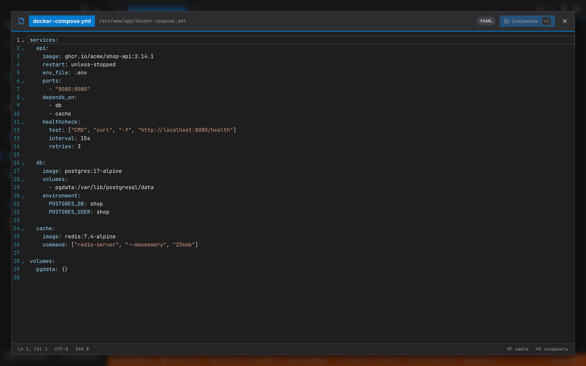
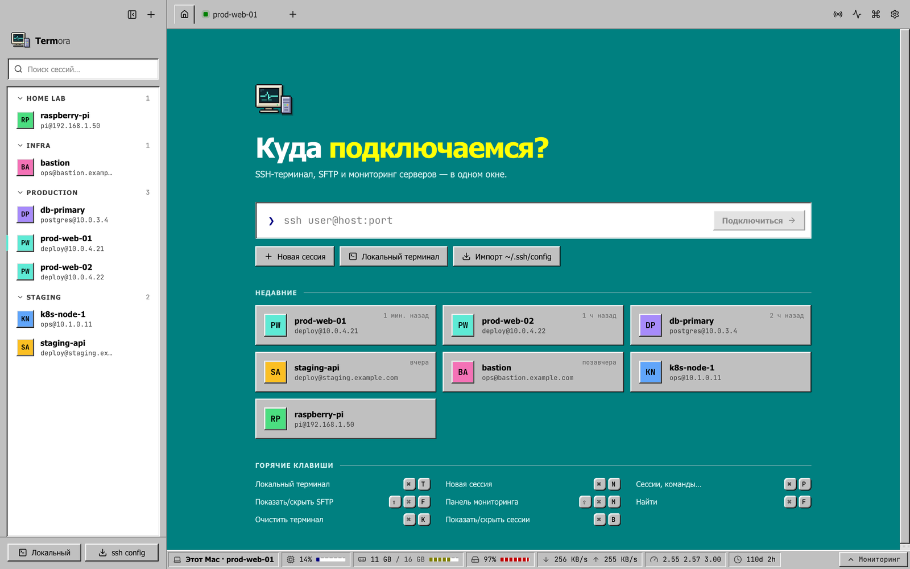
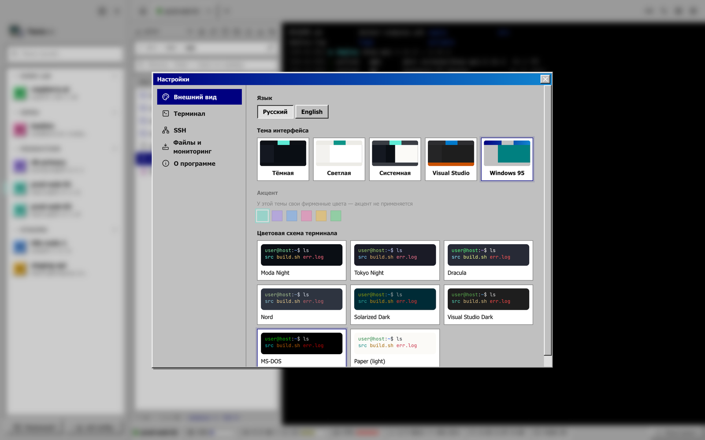
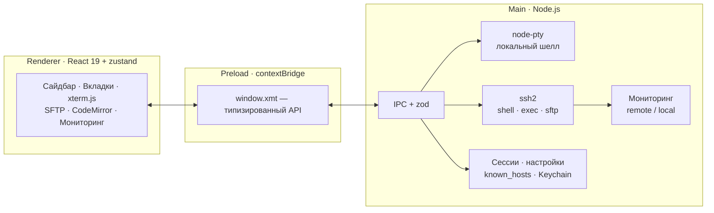

<div align="center">


# Termora

**Современный SSH-терминал для macOS в духе MobaXterm** — сохранённые сессии, SFTP-браузер с редактором файлов и живой мониторинг серверов в одном красивом окне.

[](#-скачать)
[](#-скачать)
[](https://www.electronjs.org/)
[](tsconfig.json)
[](#-тесты)
[](LICENSE)

[**⬇️ Скачать DMG**](download/) · [Возможности](#-возможности) · [Установка](#-установка) · [Горячие клавиши](#-горячие-клавиши) · [Сборка](#-сборка-из-исходников) · [English](README.en.md)


</div>

---

## ✨ Возможности

### 🖥 Терминал
- **Локальный терминал** (ваш `$SHELL` как login-shell) и **SSH-сессии** во вкладках — перетаскиваются, переключаются `⌘1…⌘9`.
- Быстрый рендер на **xterm.js + WebGL**, truecolor, Unicode 11, корректная кириллица и эмодзи.
- Поиск по выводу `⌘F`, очистка `⌘K`, кликабельные ссылки (`⌘`+клик), копирование при выделении и вставка правой кнопкой (настраивается).
- **MultiExec** — ввод сразу во все подключённые вкладки (как в MobaXterm).
- Переподключение в один клик, если сессия оборвалась.

### 🗂 Сессии
- Сохранённые подключения с **папками**, цветными метками, поиском и «недавними» на стартовом экране.
- Аутентификация: **пароль**, **SSH-ключ** (в т.ч. с паролем), **ssh-agent**, **keyboard-interactive / 2FA**.
- Пароли и passphrase хранятся **зашифрованными через macOS Keychain** — в интерфейс они не возвращаются никогда.
- **Импорт из `~/.ssh/config`** одной кнопкой, быстрое подключение строкой `user@host:port` или `ssh -p 2222 user@host`.
- Команда при входе (например `cd /var/www && git status`).

### 📁 SFTP-браузер и редактор файлов
- Панель файлов сервера рядом с терминалом: **хлебные крошки** пути, переход вверх/домой, изменяемая ширина.
- **Сортировка** по имени, размеру и дате изменения (клик по заголовку, повторный — обратный порядок; папки всегда сверху).
- **Фильтр** по текущей папке (поддерживает `*.log`, `?`) и **рекурсивный поиск по серверу** по `Enter` — быстро находит файлы во вложенных папках.
- **Встроенный редактор** (CodeMirror 6): подсветка ~20 языков (YAML, JSON, Python, JS/TS, Nginx, Dockerfile, Shell, INI/.env, SQL, Markdown…), поиск, `⌘S` — сохранить прямо на сервер. Если файл изменили на сервере после открытия — приложение предупредит и не перезапишет его молча.
- Загрузка файлов и папок **перетаскиванием из Finder**, скачивание (в `~/Downloads` или в выбранную папку), очередь передач с прогрессом.
- Создание файлов и папок, переименование, удаление, **права доступа (chmod)**, копирование пути, мультивыделение `⌘`/`⇧`.
- Статистика внизу панели: количество объектов, общий и выбранный размер.

### 📊 Мониторинг сервера
- **Нижний тулбар** как в MobaXterm: CPU, память, диск, сеть ↓/↑, load average, аптайм, пользователи.
- **Панель мониторинга** (`⇧⌘M`): графики CPU/памяти/сети за последние минуты, все диски, swap, топ процессов, ОС и ядро.
- Работает **без установки агентов**: статистика читается по тому же SSH-соединению из `/proc` (Linux) или `sysctl`/`vm_stat` (macOS).
- Для локальной вкладки показывается нагрузка вашего Mac.

### 🎨 Интерфейс и темы
- **5 тем оформления:** тёмная, светлая, системная, **Visual Studio** (как VS 2019 Dark: синяя активная вкладка, оранжевая строка состояния, подсветка VS) и олдскульная **Windows 95** (серые объёмные кнопки, синие заголовки окон, бирюзовый рабочий стол, графики как в Диспетчере задач).
- 8 цветовых схем терминала: Moda Night, Tokyo Night, Dracula, Nord, Solarized Dark, Visual Studio Dark, MS-DOS, Paper; 6 акцентных цветов.
- Подсказки при наведении на все кнопки (с горячими клавишами), **ширина панели сессий и SFTP меняется перетаскиванием** границы (двойной клик — по умолчанию).
- Пиксельная иконка в стиле 90-х и лёгкие ретро-детали: «светодиодные» индикаторы, графики на сетке.
- Палитра команд `⌘P`, уведомления, полностью **русский и английский** интерфейс.

<details>
<summary><b>📸 Ещё скриншоты</b></summary>

| Стартовый экран | Редактор файлов |
|---|---|
|  |  |
| **Поиск по серверу** | **Светлая тема** |
|  |  |
| **Тема Visual Studio** | **Редактор в теме Visual Studio** |
|  |  |
| **Тема Windows 95** | **Рабочий стол Windows 95** |
|  |  |
| **Настройки и выбор темы** | **Настройки (тёмная)** |
|  |  |

<sub>Скриншоты сняты на демо-проекте; имя хоста и пользователя заменены на демонстрационные.</sub>
</details>

---

## ⬇️ Скачать

| Файл | Платформа |
|---|---|
| [**download/Termora-1.1.0-arm64.dmg**](download/) | macOS 13+ · Apple Silicon (M1/M2/M3/M4) |

Тот же DMG прикреплён к [последнему релизу](../../releases/latest).

## 📦 Установка

1. Откройте DMG и перетащите **Termora** в папку **Applications**.
2. Запустите приложение из Launchpad или Applications.

### 🔓 Как добавить исключение macOS (Gatekeeper)

Приложение собрано без платного сертификата Apple Developer, поэтому при первом запуске macOS может написать
*«Не удаётся проверить разработчика»* или *«Приложение повреждено»*. Это ожидаемо — добавьте исключение **любым** способом:

- **Через Finder:** правый клик по `Termora.app` в Applications → **Открыть** → в диалоге снова **Открыть**.
- **Через Настройки:** Системные настройки → **Конфиденциальность и безопасность** → внизу «Termora заблокировано» → **Всё равно открыть**.
- **Одной командой в Терминале** (снимает карантин со скачанного приложения):

```bash
xattr -dr com.apple.quarantine /Applications/Termora.app
```

После этого приложение открывается обычным двойным кликом.

---

## ⌨️ Горячие клавиши

| Действие | Клавиши |
|---|---|
| Новый локальный терминал | `⌘T` |
| Новая SSH-сессия | `⌘N` |
| Палитра команд | `⌘P` |
| Закрыть вкладку / редактор | `⌘W` |
| Переключить вкладку | `⌘1…⌘9`, `⌃Tab`, `⌃⇧Tab` |
| Поиск в терминале / редакторе | `⌘F` |
| Очистить терминал | `⌘K` |
| Сохранить файл в редакторе | `⌘S` |
| Панель сессий | `⌘B` |
| SFTP-панель | `⇧⌘F` |
| Панель мониторинга | `⇧⌘M` |
| Настройки | `⌘,` |
| SFTP: вверх / открыть / удалить / выделить всё | `⌫` / `↩` / `⌘⌫` / `⌘A` |

---

## 🔐 Безопасность

- **Проверка ключа хоста (TOFU):** при первом подключении показывается SHA256-отпечаток ключа сервера; при его изменении — громкое предупреждение о возможной MITM-атаке и подключение блокируется до вашего решения.
- **Секреты в Keychain:** пароли и passphrase шифруются через Electron `safeStorage` (ключ хранится в связке ключей macOS). В рендерер передаётся только флаг «пароль сохранён».
- **Изолированный интерфейс:** `contextIsolation`, `sandbox`, без `nodeIntegration`, строгий CSP, запрет навигации и открытия окон; внешние ссылки — только `http(s)`.
- **Валидация IPC:** все вызовы из интерфейса в основной процесс проверяются схемами `zod`.
- **Удалённые команды без инъекций:** скрипт мониторинга статичен, а поиск по серверу передаётся в `sh -s` через stdin с POSIX-экранированием; «сторож» завершает поиск на сервере через 13 секунд.
- **Скачивание без path traversal:** имена файлов от сервера проверяются, файлы не перезаписываются (`file (1).txt`).

Данные приложения: `~/Library/Application Support/Termora/` — `sessions.json`, `settings.json`, `known_hosts.json`.

## 📈 Что выполняется на сервере для мониторинга

Один долгоживущий `exec`-канал по уже открытому SSH-соединению (без установки чего-либо) раз в N секунд печатает:
`uname`, `/proc/stat`, `/proc/meminfo`, `/proc/loadavg`, `/proc/uptime`, `/proc/net/dev`, `df -kP`, `who`, `ps` — на Linux;
`top -l 2`, `sysctl`, `vm_stat`, `netstat -ib`, `df -kP`, `ps` — на macOS. Мониторинг можно выключить глобально или для отдельной сессии.

---

## 🛠 Сборка из исходников

Требования: macOS, **Node.js 22+**, Xcode Command Line Tools (`xcode-select --install`).

```bash
git clone https://github.com/nikserbur/termora.git && cd termora
npm install          # зависимости + исправление прав node-pty
npm run dev          # запуск в режиме разработки с hot reload
npm test             # unit-тесты (vitest)
npm run dist         # сборка DMG → dist/Termora-<версия>-arm64.dmg
```

Иконка и фон DMG генерируются из SVG: `npm run icon`.

### 🧪 Тесты

- **Unit** (`npm test`): парсеры статистики Linux/macOS, сортировка/фильтр файлов, экранирование и разбор поиска, `~/.ssh/config`, быстрый ввод `user@host:port`, known_hosts, батчинг вывода терминала.
- **E2E** (`npm run e2e` после `npm run build`): Playwright управляет настоящим приложением — локальный шелл с UTF-8, SSH по ключу, подтверждение ключа хоста, SFTP (загрузка, поиск, сортировка, редактирование с сохранением, chmod, удаление), мониторинг, переподключение, настройки и тема.
  Для SSH-части задайте `XMT_E2E_SSH_HOST`, `XMT_E2E_SSH_PORT`, `XMT_E2E_SSH_USER`, `XMT_E2E_SSH_KEY`.

## 🧩 Архитектура



```
src/
├── main/            # основной процесс: SSH, PTY, SFTP, мониторинг, хранилища, IPC
│   ├── ssh/         # подключение, цепочка аутентификации, импорт ~/.ssh/config
│   ├── sftp/        # файловые операции, передачи, поиск по серверу
│   ├── monitor/     # скрипт мониторинга и парсеры Linux/macOS
│   └── store/       # сессии (Keychain), настройки, known_hosts
├── preload/         # безопасный мост window.xmt
├── renderer/        # интерфейс на React
└── shared/          # общие типы, IPC-каналы, форматирование, сортировка
e2e/                 # Playwright-сценарии и генерация скриншотов
```

**Стек:** Electron 44 · React 19 · TypeScript (strict) · xterm.js 6 · ssh2 · node-pty · CodeMirror 6 · zustand · zod · systeminformation · electron-vite · electron-builder · Vitest · Playwright.

## 🗺 Планы

- [ ] Проброс портов и jump-host (ProxyJump)
- [ ] Разделение окна на панели (split view)
- [ ] Universal-сборка (Intel + Apple Silicon), подпись и нотаризация
- [ ] Автообновление
- [ ] Синхронизация сессий между Mac

## ❓ Частые вопросы

<details>
<summary>«Приложение повреждено и не может быть открыто»</summary>

Это Gatekeeper для неподписанных приложений — см. [Как добавить исключение macOS](#-как-добавить-исключение-macos-gatekeeper).
</details>

<details>
<summary>Мониторинг показывает «Сбор статистики…»</summary>

Первые цифры появляются через 1–2 интервала. На минимальных системах (BusyBox без `/proc` или `ps -o`) часть метрик может отсутствовать. Интервал меняется в Настройки → Файлы и мониторинг.
</details>

<details>
<summary>Предупреждение «Ключ хоста изменился!»</summary>

Сервер предъявил ключ, отличный от сохранённого. Если вы переустанавливали сервер — подтвердите замену ключа. Если нет — не подключайтесь и выясните причину.
</details>

## 📄 Лицензия

[MIT](LICENSE) — используйте, изменяйте и распространяйте свободно.
