<div align="center">

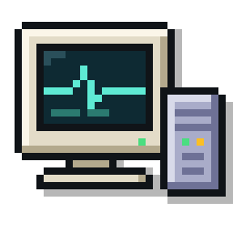

# Northshell

A free, open-source MobaXterm alternative for macOS: an SSH client and terminal with an SFTP file browser, a built-in remote file editor and live server monitoring in one window.

[](https://github.com/nikserbur/northshell/releases/latest)
[](#requirements)
[](LICENSE)

[Download](#installation) · [Features](#features) · [Screenshots](#screenshots) · [Getting started](#getting-started) · [Build from source](#building-from-source) · [Русский](README.ru.md)

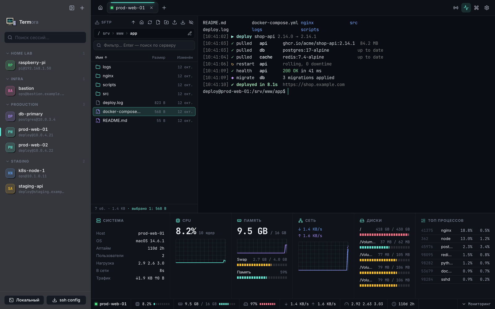

</div>

## Why Northshell

MobaXterm is a popular all-in-one SSH tool, but it only runs on Windows. Northshell brings the same workflow to the Mac: open a saved session, and the remote files appear in a panel next to the terminal while a status bar shows how the server is doing. Edit a config file in place, drag a backup to Finder, check disk usage, all without switching apps or installing anything on the server.

## Features

**Terminal**
- Local shell and SSH sessions in tabs, powered by xterm.js with GPU rendering, true colour and full Unicode.
- Find in output, clickable links, copy on select and right-click paste (optional).
- Broadcast input to every connected tab (MultiExec), one-click reconnect.
- Optional MobaXterm-style output highlighting (IP addresses, URLs, `error` / `warning` / `ok` keywords) and a session info box on connect.

**Sessions and authentication**
- Saved sessions with folders, colour tags and search; one-click import from `~/.ssh/config`.
- Quick connect with `user@host:port` or `ssh -p 2222 user@host`.
- Password, private key (with passphrase), ssh-agent and keyboard-interactive / 2FA authentication.
- Passwords and passphrases are encrypted with the macOS Keychain and never shown in the UI.
- Host keys are checked on every connection (SHA-256 fingerprints, warning if a key changes).

**Command library**
- Save frequent commands once and run them with a double-click from the side panel (`⇧⌘L`) or from the command palette (`⌘P`).
- Commands are **shared** (every connection) or **private** to one connection; *Run* presses Enter, *Insert* only types the command.
- Placeholders: `{{id}}` or `{{limit:20}}` ask for a value before the command runs.
- Stored in a plain `commands.json` you can edit by hand — changes appear in the app immediately; import and export to share a library between Macs or with your team.

**HTTP environments (curl)**
- A connection type for APIs with no SSH at all: a local terminal prepared for repeated `curl` requests to one server.
- `$BASE_URL` and `$TOKEN` (token kept in the Keychain) are set in the shell, and your default headers (e.g. `Authorization: Bearer $TOKEN`) are added to every `curl` automatically.
- Optional `curl -k` for self-signed certificates; keep the environment's typical requests in its own section of the command library.

**SFTP browser and editor**
- File panel next to the terminal with breadcrumbs, sorting by name, size or date, and a resizable width.
- Instant filter for the current folder and recursive search on the server.
- Built-in editor with syntax highlighting for about 20 languages; `⌘S` saves straight to the server and warns if the file changed remotely in the meantime.
- Upload by dragging files from Finder, download queue with progress, new file / folder, rename, delete, permissions (chmod).

**Server monitoring**
- Status bar with CPU, memory, disk, network, load, uptime and users for the active connection.
- Monitor panel (`⇧⌘M`) with CPU, memory and network graphs, all disks, swap and top processes.
- No agent to install: statistics are read over the same SSH connection (Linux and macOS servers).

**Appearance**
- Six themes: Dark, Light, System, Visual Studio, MobaXterm and Windows 95.
- Nine terminal colour schemes, adjustable font, cursor and scrollback; English and Russian UI.

## Screenshots

| Start screen and recent sessions | Remote file editor |
|---|---|
| 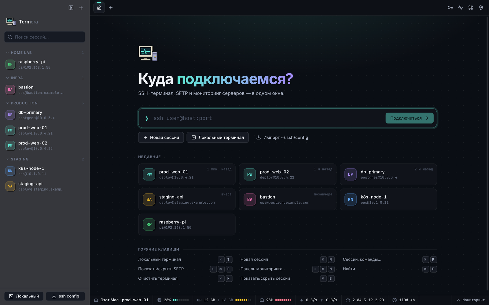 | 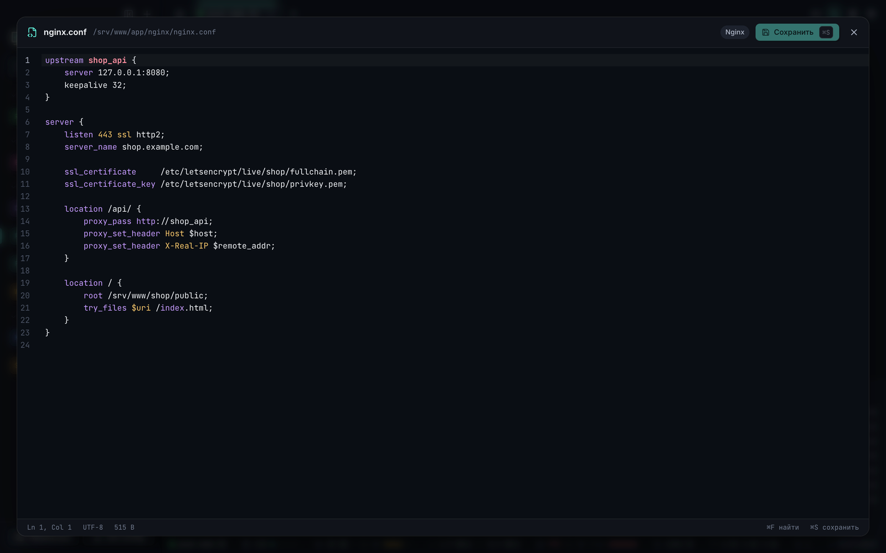 |
| **File actions in the SFTP browser** | **Recursive search on the server** |
| 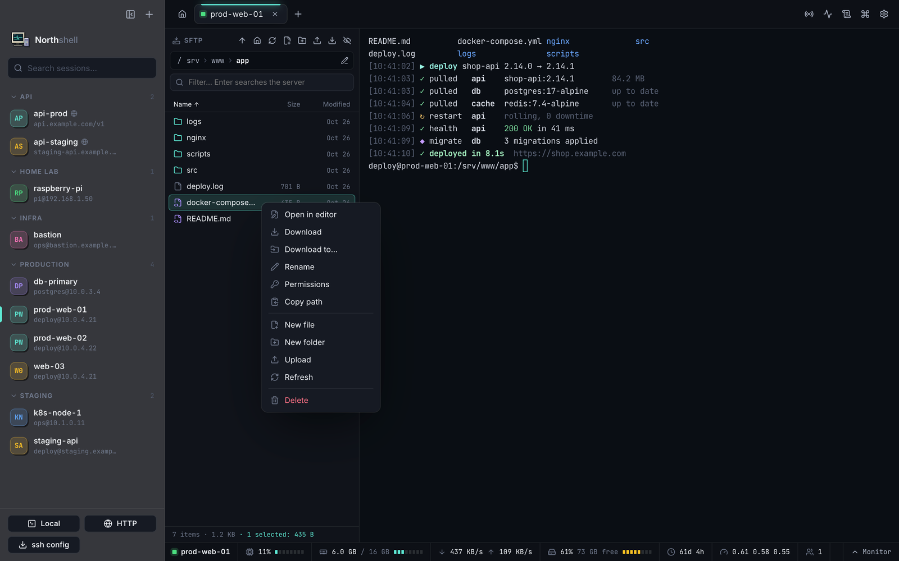 | 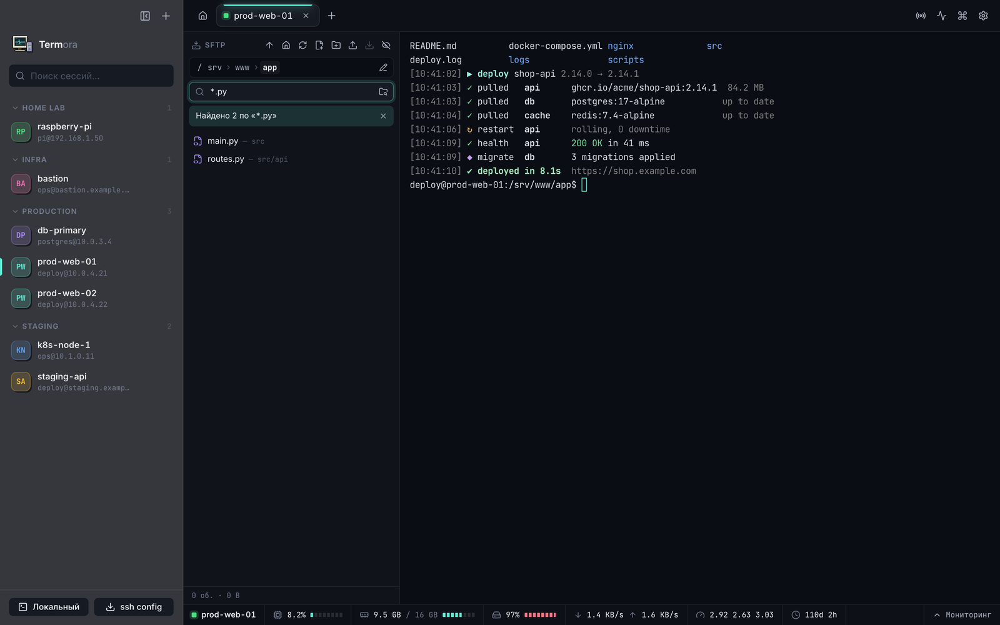 |
| **New session** | **Host key verification** |
| 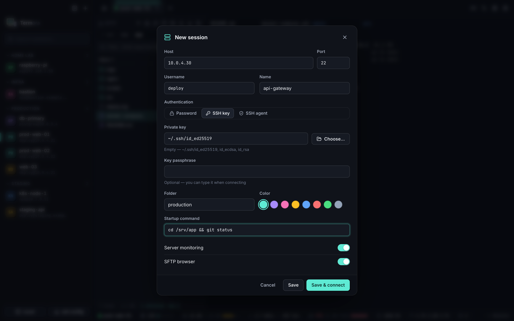 | 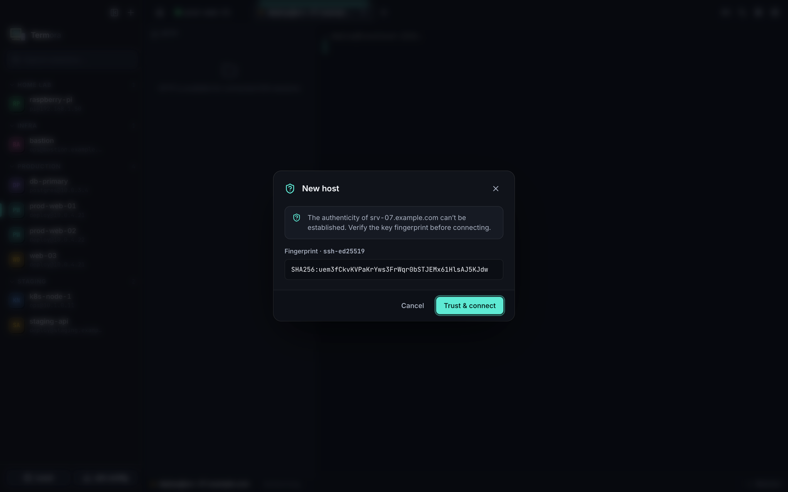 |
| **Command palette** | **Settings** |
| 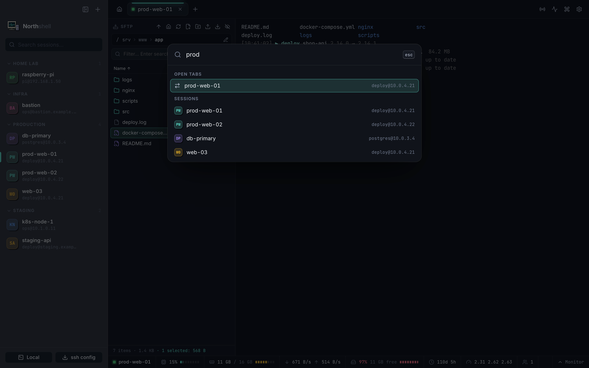 | 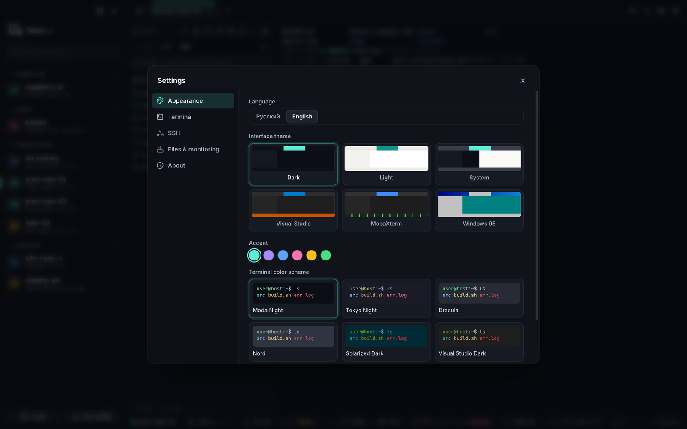 |
| **MobaXterm theme with output highlighting** | **Visual Studio theme** |
| 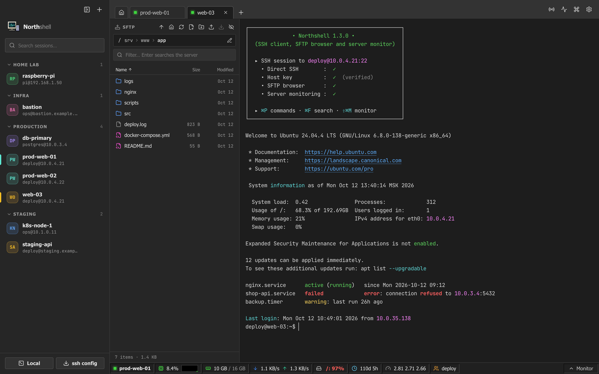 | 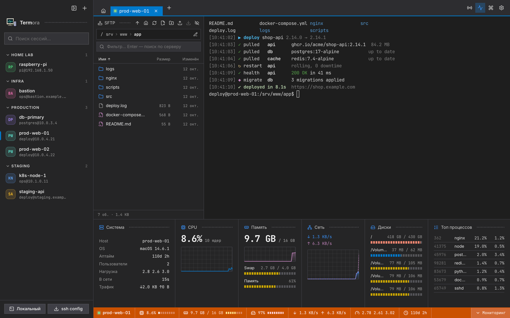 |
| **Windows 95 theme** | **Light theme** |
| 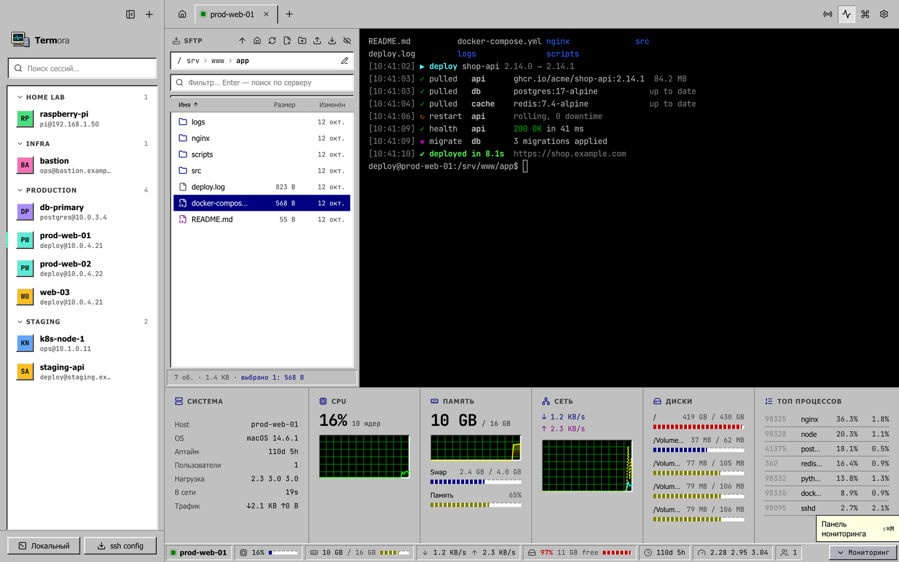 | 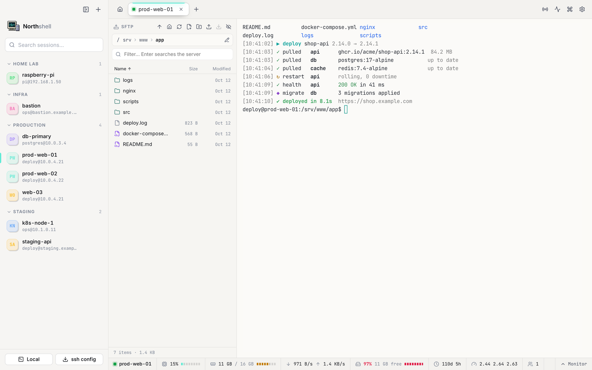 |

Screenshots were taken against a demo project; host and user names are placeholders.

## Installation

### Requirements

- macOS 13 Ventura or later
- A Mac with Apple Silicon (M1, M2, M3 or M4)

### Download

| File | Size |
|---|---|
| [`Northshell-<version>-arm64.dmg`](https://github.com/nikserbur/northshell/releases/latest) | ~112 MB |

Get the DMG from the **Assets** list of the [latest release](https://github.com/nikserbur/northshell/releases/latest). To check the download, compare its SHA-256 with [SHA256SUMS.txt](https://github.com/nikserbur/northshell/releases/latest/download/SHA256SUMS.txt) from the same release:

```bash
shasum -a 256 ~/Downloads/Northshell-*-arm64.dmg
```

### Install

1. Open the downloaded `Northshell-<version>-arm64.dmg`.
2. Drag **Northshell** onto the **Applications** folder in the window that appears.
3. Eject the disk image (drag it to the Trash or press `⌘E` in Finder).
4. Start Northshell from Applications, Launchpad or Spotlight.

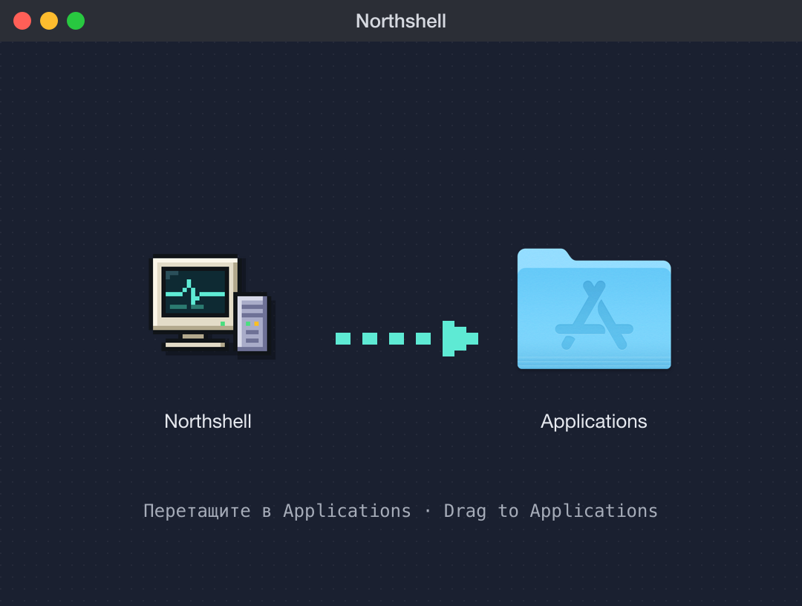

### First launch

Northshell is not signed with a paid Apple Developer certificate, so macOS blocks the first launch of the downloaded copy. Allow it once in one of these ways:

- **macOS 15 Sequoia and later:** open Northshell, close the warning, then go to **System Settings → Privacy & Security**, scroll down to the message about Northshell and click **Open Anyway**. Confirm with your password.
- **macOS 13–14:** in Finder, Control-click (or right-click) Northshell in Applications, choose **Open**, then click **Open** in the dialog.
- **Any version, from Terminal:**

  ```bash
  xattr -dr com.apple.quarantine /Applications/Northshell.app
  ```

After that the app opens normally.

When you save a password for the first time, macOS asks whether Northshell may use its Keychain item **Northshell Safe Storage**. Choose **Always Allow**. After installing a new version macOS may ask again.

### Updating

Download the new DMG and drag Northshell into Applications again, replacing the old copy. Sessions, settings and known hosts are kept.

### Uninstalling

1. Quit Northshell and move it from Applications to the Trash.
2. Remove its data folder: `rm -rf ~/Library/Application\ Support/Northshell`
3. Optionally delete **Northshell Safe Storage** in Keychain Access.

## Getting started

1. **Connect quickly.** On the start screen type `user@host` (or `ssh -p 2222 user@host`) and press Enter.
2. **Save a session.** Press `⌘N`, enter the host, user and authentication method, then **Save & connect**. Sessions can be grouped into folders.
3. **Import existing hosts.** Click **ssh config** at the bottom of the sidebar to import entries from `~/.ssh/config`.
4. **Confirm the server key.** On the first connection Northshell shows the server's fingerprint. Compare it with the one from your hosting provider or from `ssh-keygen -lf /etc/ssh/ssh_host_ed25519_key.pub` on the server.
5. **Work with files.** Drag files from Finder onto the SFTP panel to upload, double-click a file to edit it, press `⌘S` to save. Type in the filter field and press Enter to search the whole folder tree.
6. **Watch the server.** The status bar shows live statistics; click it or press `⇧⌘M` for the full monitor.
7. **Save frequent commands.** Press `⇧⌘L` to open the command library, click **+**, and choose whether the command is shared or belongs to one connection. Double-click a command to run it.
8. **Work with an HTTP API.** Click **HTTP** at the bottom of the sidebar (or `⌥⌘N`), enter a base URL, an optional token and headers, then **Save & open**. In the terminal run `curl $BASE_URL/health` — the headers are added for you.
9. **Change the look.** Open **Settings → Appearance** (`⌘,`) to choose a theme and terminal colours.

## Keyboard shortcuts

| Action | Shortcut |
|---|---|
| New local terminal | `⌘T` |
| New SSH session | `⌘N` |
| New HTTP environment | `⌥⌘N` |
| Command library | `⇧⌘L` |
| Command palette | `⌘P` |
| Close tab or editor | `⌘W` |
| Switch tab | `⌘1` … `⌘9`, `⌃Tab`, `⌃⇧Tab` |
| Find in terminal or editor | `⌘F` |
| Clear terminal | `⌘K` |
| Save file in editor | `⌘S` |
| Show / hide sessions, SFTP, monitor | `⌘B`, `⇧⌘F`, `⇧⌘M` |
| Settings | `⌘,` |

## Security

- Host keys are verified on every connection; a changed key blocks the connection until you decide.
- Secrets are encrypted with Electron `safeStorage` (macOS Keychain) and never sent to the interface.
- The interface runs sandboxed with context isolation and a strict Content Security Policy; every request to the main process is validated.
- Remote commands for monitoring and search are fixed scripts with quoted arguments; a server-side search stops on its own after 13 seconds.
- SFTP downloads never overwrite existing files and reject unsafe names; deleting a symlink never touches its target.
- HTTP environments write their curl headers to a private temporary folder (owner-only permissions) that is deleted when the tab closes.

App data lives in `~/Library/Application Support/Northshell/` (`sessions.json`, `commands.json`, `settings.json`, `known_hosts.json`).

## Northshell and other SSH clients for Mac

Tabby, Electerm and WindTerm are cross-platform terminals with SSH and SFTP. Termius and Royal TSX are commercial connection managers. iTerm2 is an excellent terminal without file transfer, and Cyberduck, Transmit or ForkLift handle files but not the shell.

Northshell focuses on the MobaXterm way of working on macOS:

- the SFTP browser sits next to the terminal of the same session, so there is no second login;
- remote files open in a built-in code editor and are saved back with `⌘S`;
- a live server monitor (CPU, memory, disks, network, load, users) runs over the same SSH connection with no agent on the server;
- it is free, open source (MIT) and stores secrets in the macOS Keychain.

## FAQ

**Is there a MobaXterm for Mac?**
MobaXterm itself is Windows-only. Northshell is a macOS app built around the same idea: SSH terminal, SFTP browser and server monitoring in one window. It does not include MobaXterm's X11 server or Windows tools.

**Is Northshell free?**
Yes. It is open source under the MIT license, with no account, subscription or telemetry.

**Does it run on Intel Macs?**
The published build is for Apple Silicon. Intel Macs can build it from source; a universal build is not published yet.

**Do I need to install anything on my servers?**
No. Monitoring uses standard commands (`/proc` on Linux, `sysctl` and `vm_stat` on macOS) over the existing SSH connection. SFTP needs the usual `sftp-server`, which is part of OpenSSH.

**Which authentication methods are supported?**
Passwords, private keys (OpenSSH, with or without a passphrase), ssh-agent and keyboard-interactive prompts such as one-time codes. Hosts from `~/.ssh/config` can be imported.

**Where are my passwords stored?**
Encrypted with the macOS Keychain on your Mac. Nothing is sent anywhere else.

**Can I edit files on the server?**
Yes. Double-click a text file in the SFTP panel to open it in the built-in editor with syntax highlighting, then press `⌘S` to save. Files up to 5 MB are supported; larger or binary files can be downloaded.

**Why does macOS say the app cannot be opened?**
The app is not notarized by Apple. See [First launch](#first-launch) for the one-time steps.

## Limitations

- Apple Silicon build only; not signed or notarized by Apple.
- No X11 forwarding, RDP, VNC, serial connections, port forwarding or jump hosts yet.
- Server monitoring supports Linux and macOS hosts; on BusyBox-only systems some values may be missing.

## Building from source

Requires macOS, Node.js 22 or later and the Xcode Command Line Tools.

```bash
git clone https://github.com/nikserbur/northshell.git
cd northshell
npm install
npm run dev      # run with hot reload
npm test         # unit tests
npm run dist     # build the DMG into dist/
```

End-to-end tests drive the built app with Playwright: run `npm run build && npm run e2e`. Set `XMT_E2E_SSH_HOST`, `XMT_E2E_SSH_PORT`, `XMT_E2E_SSH_USER` and `XMT_E2E_SSH_KEY` to include the SSH and SFTP scenarios.

Built with Electron, React, TypeScript, xterm.js, ssh2, node-pty and CodeMirror.

## License

[MIT](LICENSE)
